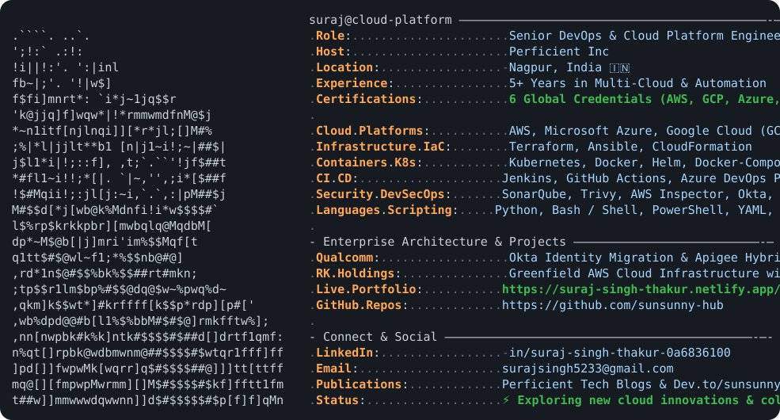

  <!-- Interactive Terminal Neofetch with Suraj's ASCII Face (Inspired by Andrew6Grant / awesome-github-profile-readme) -->
  <a href="https://suraj-singh-thakur.netlify.app/">
    <picture>
      <source media="(prefers-color-scheme: dark)" srcset="./dark_mode.svg">
      <source media="(prefers-color-scheme: light)" srcset="./light_mode.svg">
      
    </picture>
  </a>

    

  <!-- Direct Portals & Action Buttons -->
  

    
    
    
    
    
  

---

### 🏆 Verified Global Certifications

| Cloud / Platform | Credential Name | Verification Link |
| :---: | :--- | :---: |
|  | **AWS Certified Solutions Architect – Associate** | [Verify on Credly ↗](https://www.credly.com/badges/78a1103c-ecf2-4a6c-9932-565bf2b6591e/public_url) |
|  | **Google Cloud Certified: Associate Cloud Engineer** | [Verify on Accredible ↗](https://www.credential.net/131745c8-6602-4aff-bfe0-a07f0e6d0003) |
|  | **Microsoft Certified: Azure Security Engineer Associate (AZ-500)** | [Verify on MS Learn ↗](https://learn.microsoft.com/api/credentials/share/en-us/surajsingh-5992/5A930C5769F8C404?sharingId=442D4838F487B16A) |
|  | **Microsoft Certified: Azure Administrator Associate (AZ-104)** | [Verify on Credly ↗](https://www.credly.com/badges/53d13878-236f-4242-af6d-ac20752cdc84/public_url) |
|  | **Microsoft Certified: Azure Fundamentals (AZ-900)** | [Verify on Credly ↗](https://www.credly.com/badges/07ecd1e8-5da8-42a5-bd01-9d7e5a608da2/public_url) |
|  | **Red Hat Certified System Administrator (RHCSA)** | [Verify on Red Hat ↗](https://rhtapps.redhat.com/verify?certId=170-199-541) |

> 📌 *For in-depth case studies on enterprise cloud migrations (Qualcomm, RK Holdings), architecture diagrams, and work experience, visit [**suraj-singh-thakur.netlify.app**](https://suraj-singh-thakur.netlify.app/).*

---

### 📊 GitHub Activity & Metrics

  <table>
    <tr>
      <td align="center" width="50%">
        
      </td>
      <td align="center" width="50%">
        
      </td>
    </tr>
  </table>

  <!-- Contribution Grid Snake Animation -->
  <picture>
    <source media="(prefers-color-scheme: dark)" srcset="https://raw.githubusercontent.com/sunsunny-hub/sunsunny-hub/output/github-contribution-grid-snake-dark.svg">
    <source media="(prefers-color-scheme: light)" srcset="https://raw.githubusercontent.com/sunsunny-hub/sunsunny-hub/output/github-contribution-grid-snake.svg">
    
  </picture>

---

### 📝 Latest Technical Publications
<!-- BLOG-POST-LIST:START -->
- [Getting Started with Matillion ETL Tool](https://dev.to/sunsunnyhub/getting-started-with-matillion-etl-tool-36g4)
- [Transform Your Data with Azure Data Factory](https://dev.to/sunsunnyhub/transform-your-data-with-azure-data-factory-3h0o)
<!-- BLOG-POST-LIST:END -->

  <a href="https://blogs.perficient.com/author/sthakur/">Read more engineering deep-dives on Perficient Blogs ↗</a>

