<div align="center">

  <!-- Interactive Hero Banner (Stored locally in the repo for 100% reliable rendering) -->
  <a href="https://suraj-singh-thakur.netlify.app/">
    
  </a>

  <br />

  <!-- Visitor Counter & Quick Status Badges -->
  <p align="center">
    <a href="https://github.com/sunsunny-hub">
      
    </a>
    
    
    
  </p>

  <!-- Dynamic Typing SVG -->
  <a href="https://suraj-singh-thakur.netlify.app/">
    
  </a>

  <br /><br />

  <!-- Social & Portfolio Hub -->
  <p align="center">
    <a href="https://suraj-singh-thakur.netlify.app/"></a>
    <a href="https://www.linkedin.com/in/suraj-singh-thakur-0a6836100/"></a>
    <a href="mailto:surajsingh5233@gmail.com"></a>
    <a href="https://blogs.perficient.com/author/sthakur/"></a>
    <a href="https://dev.to/sunsunnyhub"></a>
    <a href="https://drive.google.com/file/d/12Ztb_acOKf_slRDkL023qwlaAQzc2xz_/view?usp=drive_link"></a>
  </p>

</div>

---

### ⚡ System Profile (`suraj-platform.yml`)

```yaml
engineer:
  name: "Suraj Singh Thakur"
  title: "Senior DevOps & Multi-Cloud Platform Engineer"
  company: "Perficient Inc"
  location: "Nagpur, India 🇮🇳"
  experience: "5+ Years Enterprise Cloud Architecture"

core_domains:
  multi_cloud: ["AWS", "Microsoft Azure", "Google Cloud Platform (GCP)"]
  infrastructure_as_code: ["Terraform", "Ansible", "AWS CloudFormation"]
  containers_orchestration: ["Kubernetes (EKS / AKS / GKE)", "Docker", "Helm"]
  ci_cd_pipelines: ["Jenkins", "GitHub Actions", "Azure DevOps", "Bitbucket Pipelines"]
  devsecops_governance: ["SonarQube", "Trivy", "AWS Inspector", "Okta Identity", "Apigee Hybrid"]
  observability_monitoring: ["Prometheus", "Grafana", "AWS CloudWatch", "Azure Monitor"]
  scripting_automation: ["Python", "Bash / Shell", "PowerShell", "YAML / JSON"]

mission: "Architecting self-healing, zero-downtime, and compliant cloud platforms with end-to-end automation."
```

---

### 🏆 Honors & Global Certifications

<div align="center">

| Cloud Provider | Global Certification | Verification Link |
| :---: | :--- | :---: |
|  | **AWS Certified Solutions Architect – Associate** | [Verify Credential ↗](https://www.credly.com/badges/78a1103c-ecf2-4a6c-9932-565bf2b6591e/public_url) |
|  | **Google Cloud Certified: Associate Cloud Engineer** | [Verify Credential ↗](https://www.credential.net/131745c8-6602-4aff-bfe0-a07f0e6d0003) |
|  | **Microsoft Certified: Azure Security Engineer Associate (AZ-500)** | [Verify Credential ↗](https://learn.microsoft.com/api/credentials/share/en-us/surajsingh-5992/5A930C5769F8C404?sharingId=442D4838F487B16A) |
|  | **Microsoft Certified: Azure Administrator Associate (AZ-104)** | [Verify Credential ↗](https://www.credly.com/badges/53d13878-236f-4242-af6d-ac20752cdc84/public_url) |
|  | **Microsoft Certified: Azure Fundamentals (AZ-900)** | [Verify Credential ↗](https://www.credly.com/badges/07ecd1e8-5da8-42a5-bd01-9d7e5a608da2/public_url) |
|  | **Red Hat Certified System Administrator (RHCSA)** | [Verify Credential ↗](https://rhtapps.redhat.com/verify?certId=170-199-541) |

</div>

---

### 🛠️ Technical Arsenal

<div align="center">

  <!-- Interactive SkillIcons Widget -->
  <a href="https://skillicons.dev">
    
  </a>

</div>

<br />

| Domain | Technologies & Frameworks |
| :--- | :--- |
| **Cloud Platforms** | **Amazon Web Services (AWS)**, **Microsoft Azure**, **Google Cloud Platform (GCP)** |
| **Containers & Orchestration** | **Kubernetes (K8s)**, **Docker**, **Helm**, **Docker Compose** |
| **Infrastructure as Code (IaC)** | **Terraform**, **Ansible**, **AWS CloudFormation**, **Packer** |
| **CI/CD & Delivery** | **Jenkins**, **GitHub Actions**, **Azure DevOps Pipelines**, **Bitbucket Pipelines** |
| **Security & DevSecOps** | **SonarQube**, **Trivy**, **AWS Inspector**, **Okta Workflows**, **Google Apigee Hybrid** |
| **Observability & Monitoring** | **Prometheus**, **Grafana**, **AWS CloudWatch**, **Azure Monitor** |
| **Data & Cloud ETL** | **Azure Data Factory (ADF)**, **Matillion ETL**, **MySQL**, **PostgreSQL** |
| **Scripting & Systems** | **Python**, **Bash / Shell Scripting**, **PowerShell**, **Red Hat Enterprise Linux (RHEL)**, **Ubuntu** |

---

### 💼 Enterprise Deliverables & Architecture Highlights

- 🏢 **Qualcomm [Enterprise Okta Migration & Identity Automation]**  
  *Automated and executed identity workflow migration across lower to production environments for high-traffic enterprise API ecosystems.*
- 🏢 **Qualcomm [Google Apigee Hybrid API Platform Upgrade]**  
  *Maintained, hardened, and upgraded Google Apigee Hybrid microservices supporting mission-critical enterprise payment and identity traffic.*
- 🏢 **RK Holdings, LLP [Greenfield Multi-Cloud Infrastructure]**  
  *Architected and provisioned an enterprise AWS baseline from scratch with 100% Terraform Infrastructure as Code (IaC) across all staging and production tiers.*
- 🛡️ **DevSecOps Automated Compliance Framework**  
  *Engineered automated serverless Python Lambda pipelines to continuously poll AWS Inspector vulnerability scans and ingest security reports directly into secure S3 audit buckets.*

---

### 📝 Technical Publications & Articles

- 📖 [Azure IoT Operations: Empowering the Future of Connectivity and Automation](https://blogs.perficient.com/2025/05/27/azure-iot-operations-empowering-the-future-of-connectivity-and-automation/)
- 📖 [Revolutionizing OpenAI Chatbot UI Deployment with DevSecOps](https://blogs.perficient.com/2024/07/05/revolutionizing-openai-chatbot-ui-deployment-with-devsecops/)
- 📖 [Ultimate Guide to Setting Up Jenkins Server with DevSecOps Tools on AWS EC2](https://blogs.perficient.com/2024/07/02/ultimate-guide-to-setting-up-jenkins-server-with-devsecops-tools-on-aws-ec2/)
- 📖 [Deploying Azure Infrastructure With Terraform Using Azure DevOps Pipelines](https://blogs.perficient.com/2023/07/13/deploying-azure-infrastructure-with-terraform-using-azure-devops-pipelines/)

#### 🚀 Latest Dev.to Articles *(Auto-updated by GitHub Actions)*
<!-- BLOG-POST-LIST:START -->
- [Getting Started with Matillion ETL Tool](https://dev.to/sunsunnyhub/getting-started-with-matillion-etl-tool-36g4)
- [Transform Your Data with Azure Data Factory](https://dev.to/sunsunnyhub/transform-your-data-with-azure-data-factory-3h0o)
<!-- BLOG-POST-LIST:END -->

---

### 📊 GitHub Activity & Metrics

<div align="center">
  <table>
    <tr>
      <td align="center" width="50%">
        
      </td>
      <td align="center" width="50%">
        
      </td>
    </tr>
    <tr>
      <td align="center" colspan="2">
        
      </td>
    </tr>
  </table>
</div>

### 🐍 Contribution Activity Graph

<div align="center">
  
</div>

---

<div align="center">
  
</div>
